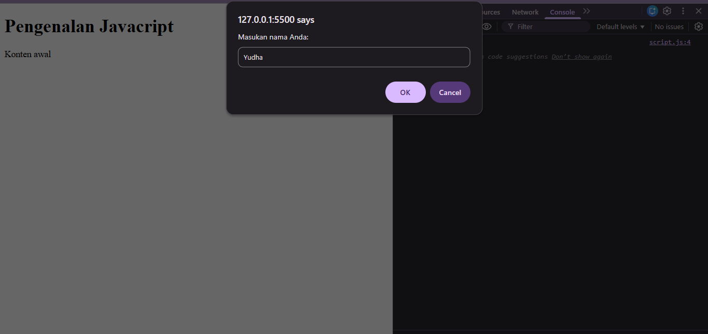
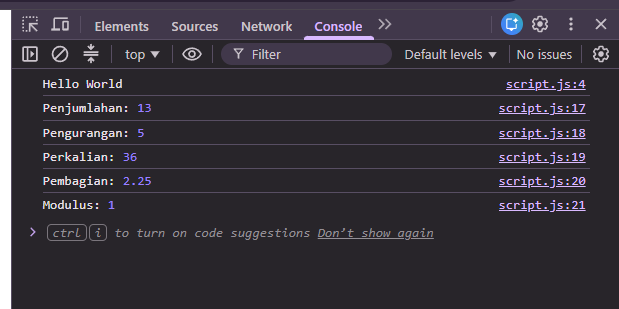
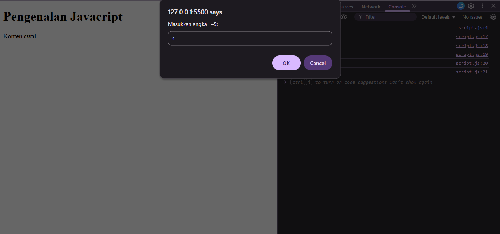
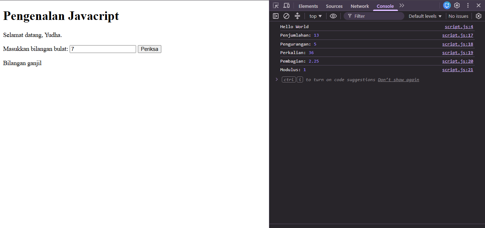
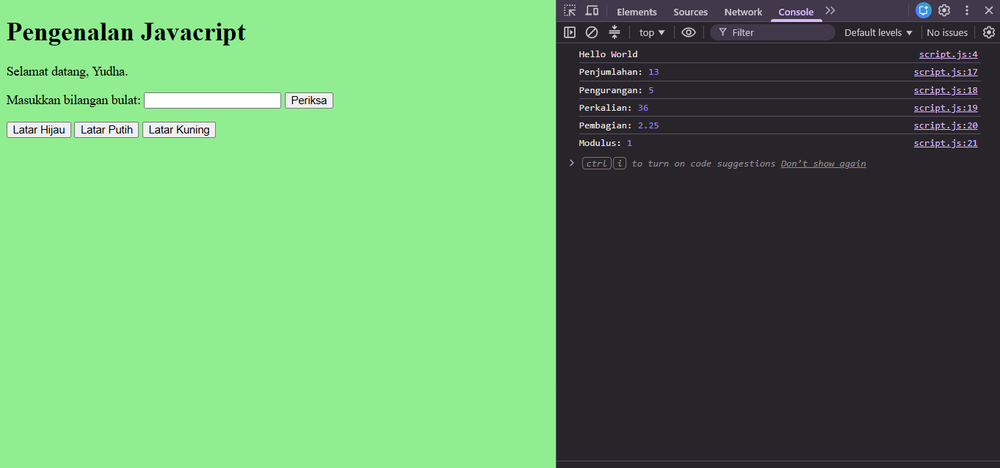
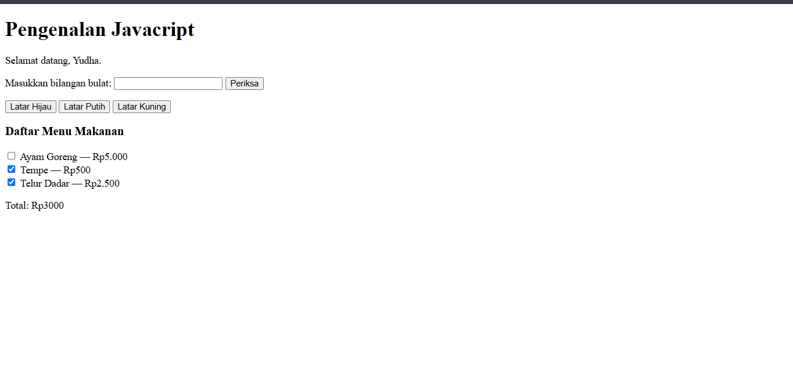

Nama: Fahreza Pratama Yudha
Kelas: I251B
NIM: 312510287

# Penjelasan Latihan Praktikum 5 — JavaScript Dasar dan Manipulasi HTML

## Latihan 1 — Menampilkan Output

**Tujuan:** Memahami cara menampilkan output menggunakan JavaScript melalui halaman HTML dan Console.

**Penjelasan:** Pada latihan ini, JavaScript digunakan untuk mengubah teks pada elemen HTML menjadi "Hello World" menggunakan `textContent`. Selain itu, perintah `console.log()` digunakan untuk menampilkan pesan yang sama pada Console browser. Latihan ini membantu memahami perbedaan output yang ditampilkan langsung pada halaman web dan output yang digunakan untuk keperluan debugging.

**Hasil:** Teks "Hello World" berhasil ditampilkan pada halaman HTML dan Console browser.

## Latihan 2 — Alert dan Prompt

**Tujuan:** Memahami penggunaan dialog interaktif untuk menerima input dan menampilkan pesan kepada pengguna.

**Penjelasan:** Pada latihan ini, fungsi `prompt()` digunakan untuk meminta pengguna memasukkan nama. Program kemudian memeriksa apakah nama telah diisi menggunakan percabangan `if-else`. Jika nama valid, program menampilkan sapaan melalui `alert()` dan memperbarui teks pada halaman HTML. Jika nama tidak diisi atau pengguna menekan Cancel, program menampilkan pesan bahwa nama belum diisi.

**Hasil:** Program dapat menerima input nama, menampilkan sapaan, serta menangani kondisi ketika nama tidak dimasukkan.

## Latihan 3 — Function dan Operasi Aritmetika

**Tujuan:** Memahami penggunaan function untuk melakukan operasi aritmetika pada dua bilangan.

**Penjelasan:** Pada latihan ini, dibuat function `operasiDasar()` yang menerima dua parameter, yaitu `a` dan `b`. Function tersebut digunakan untuk menghitung penjumlahan, pengurangan, perkalian, pembagian, dan modulus atau sisa bagi. Hasil setiap operasi ditampilkan menggunakan `console.log()`. Program juga memeriksa apakah bilangan pembagi bernilai nol untuk menghindari operasi pembagian dengan nol.

**Hasil:** Program berhasil menjalankan lima operasi aritmetika dan menampilkan hasilnya pada Console browser.

## Latihan 4 — Seleksi Kondisi If-Else

**Tujuan:** Memahami penggunaan percabangan `if-else` untuk menentukan status kelulusan berdasarkan nilai mahasiswa.

**Penjelasan:** Pada latihan ini, pengguna diminta memasukkan nilai melalui `prompt()`. Input tersebut dikonversi menjadi tipe data angka menggunakan `Number()`. Program kemudian memeriksa validitas input, termasuk memastikan nilai berada pada rentang 0–100. Jika nilai minimal 60, program menampilkan pesan "Lulus". Jika nilai kurang dari 60, program menampilkan pesan "Belum lulus".

**Hasil:** Program berhasil memvalidasi input nilai dan menentukan status kelulusan mahasiswa sesuai dengan kondisi yang telah ditentukan.

## Latihan 5 — Seleksi Kondisi Switch

**Tujuan:** Memahami penggunaan struktur `switch` untuk menentukan keluaran berdasarkan pilihan pengguna.

**Penjelasan:** Pada latihan ini, pengguna diminta memasukkan angka dari 1 sampai 5 melalui `prompt()`. Struktur `switch` digunakan untuk mencocokkan input dengan beberapa pilihan yang tersedia. Setiap pilihan menampilkan nama bilangan melalui `alert()`, sedangkan bagian `default` digunakan untuk menampilkan pesan jika input tidak sesuai dengan pilihan yang tersedia. Perintah `break` digunakan untuk mengakhiri eksekusi pada setiap kasus.

**Hasil:** Program berhasil menampilkan nama bilangan sesuai dengan angka yang dimasukkan pengguna dan memberikan pesan untuk pilihan yang tidak tersedia.

## Latihan 6 — Form Bilangan Genap atau Ganjil

**Tujuan:** Memahami penggunaan form HTML dan JavaScript untuk memeriksa apakah suatu bilangan termasuk bilangan genap atau ganjil.

**Penjelasan:** Pada latihan ini, dibuat form yang berisi kolom input bilangan dan tombol Periksa. Ketika tombol ditekan, function `cekBilangan()` mengambil nilai input dari elemen HTML dan memeriksa apakah input tersebut merupakan bilangan bulat yang valid. Operator modulus (`%`) digunakan untuk menentukan jenis bilangan. Jika sisa pembagian dengan 2 adalah 0, bilangan dinyatakan genap; jika tidak, bilangan dinyatakan ganjil.

**Hasil:** Program berhasil menentukan bilangan genap atau ganjil, termasuk menangani input kosong dan bilangan desimal yang tidak memenuhi ketentuan bilangan bulat.

## Latihan 7 — Mengubah Warna Halaman

**Tujuan:** Memahami cara memanipulasi gaya elemen HTML menggunakan JavaScript.

**Penjelasan:** Pada latihan ini, dibuat tiga tombol yang berfungsi untuk mengubah warna latar belakang halaman menjadi hijau muda, putih, atau kuning muda. Perubahan dilakukan menggunakan function `ubahWarnaLatar()` yang menerima parameter warna. Properti `document.body.style.backgroundColor` digunakan untuk mengubah warna latar halaman sesuai dengan tombol yang dipilih pengguna.

**Hasil:** Warna latar belakang halaman berhasil berubah sesuai dengan tombol yang ditekan. Penggunaan satu function dengan parameter juga membuat kode lebih ringkas dan mengurangi pengulangan instruksi.

## Latihan 8 — DOM dan Checkbox Menu Makanan

**Tujuan:** Memahami manipulasi DOM, penggunaan checkbox, dan penerapan event listener untuk menghitung total harga menu secara otomatis.

**Penjelasan:** Pada latihan ini, dibuat daftar menu makanan yang dilengkapi checkbox dan harga masing-masing. JavaScript menggunakan `document.querySelectorAll()` untuk memilih seluruh checkbox menu, kemudian memasang event listener `change` agar function `hitungTotal()` dijalankan setiap kali pilihan berubah. Function tersebut memeriksa checkbox yang dicentang, menjumlahkan harga menu yang dipilih, lalu menampilkan total harga pada halaman HTML dengan format angka Indonesia.

**Hasil:** Total harga makanan berhasil dihitung dan diperbarui secara otomatis ketika pengguna mencentang atau membatalkan pilihan menu.

---

## Kesimpulan

Berdasarkan delapan latihan yang telah dikerjakan, dapat dipahami bahwa JavaScript digunakan untuk menambahkan interaktivitas pada halaman web. Materi yang dipelajari meliputi penampilan output, penggunaan dialog, operasi aritmetika, function, percabangan, validasi input, manipulasi DOM, perubahan gaya halaman, serta pengolahan data dari form dan checkbox. Seluruh materi tersebut menjadi dasar dalam membangun halaman web yang dinamis dan interaktif.